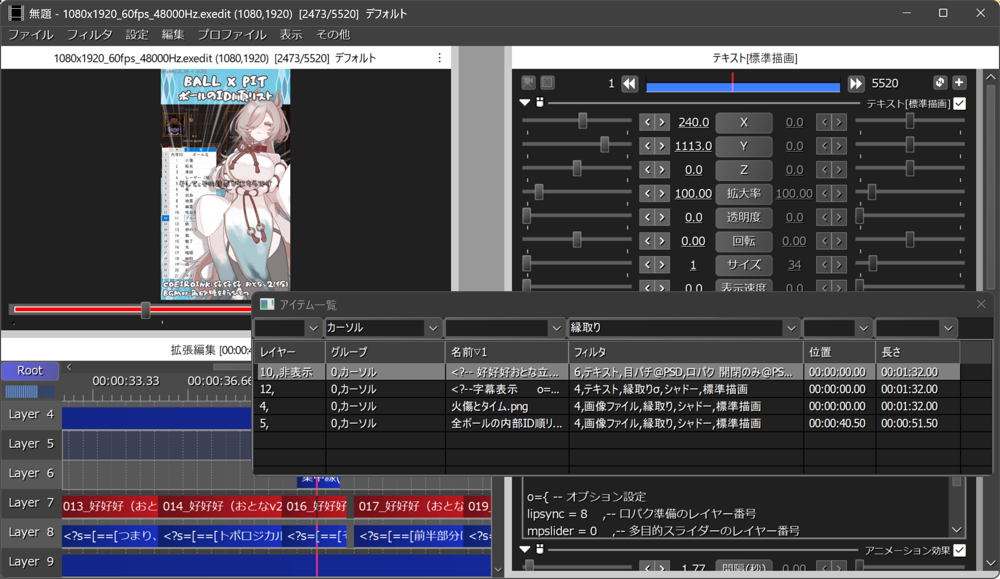

# 🚀『アイテム一覧』アドイン

* 現在のシーンに存在するアイテムの一覧を表示します。
* ※一部(レイヤーの設定など)は自動反映されない場合があります。
* ※リストビューの水平スクロールが重いのはOSの仕様です。

## 💡使い方

1. `aviutlウィンドウ`のメニューで`編集`➡`アルティメットプラグイン`➡`アイテム一覧`を選択します。
1. `アイテム一覧`ウィンドウが表示されます。
1. `タイムライン(拡張編集ウィンドウ)`に応じて表示が変わります。

## 🎨『アイテム一覧』ウィンドウ

* `絞り込み用コンボボックス` ✏️上部にあるコンボボックスです。
	* 絞り込み用テキストを入力または選択します。
	* 入力した場合はEnterキーを押すと適用されます。
* `並べ替え用ヘッダーコントロール` ✏️リストビューの上部にあります。
	* クリックするとその列を優先して`リスト`を並べ替えます。
	* 境界をドラッグすると、列幅を変更できます。
* `リスト` ✏️リストビューです。
	* 項目をクリックして選択すると、対応するアイテムがフォーカスオブジェクトになります。
	* 項目をダブルクリックすると、対応するアイテムが表示されるように、タイムラインがスクロールされます。
	* 右クリックすると`コンテキストメニュー`が表示されます。

## 🎨コンテキストメニュー

* `フレームを時間で表示` ✏️チェックを入れると、`位置`と`長さ`を時間で表示します。
* `リフレッシュ` ✏️拡張編集からアイテム一覧を読み込んで、`リスト`を更新します。
* `並び順をリセット"` ✏️`リスト`の並べ替えをリセットします。
* `絞り込みをリセット"` ✏️`リスト`の絞り込みをリセットします。
